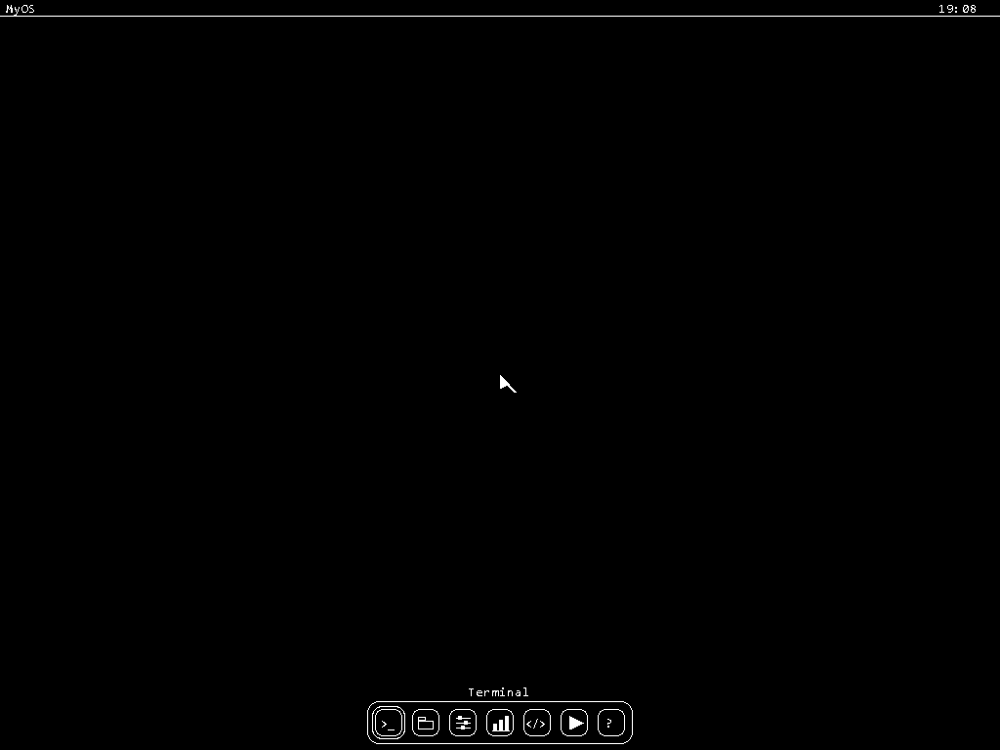
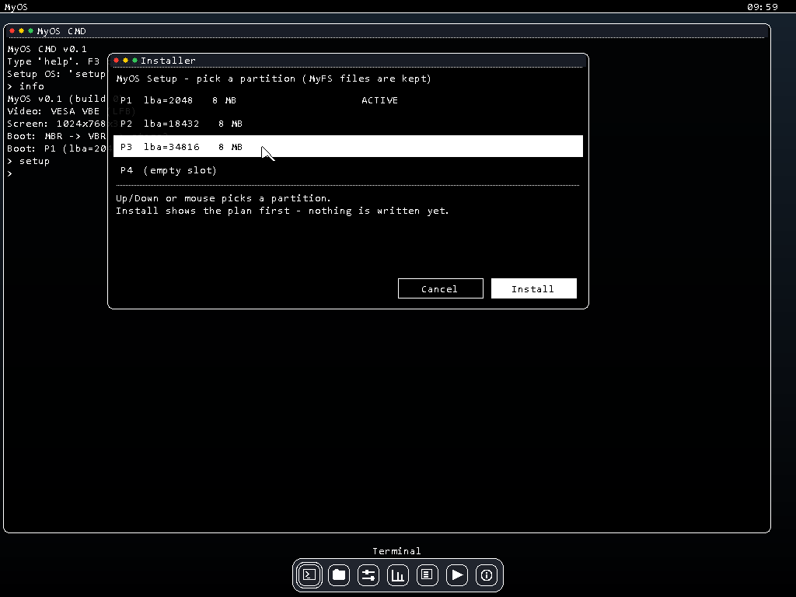
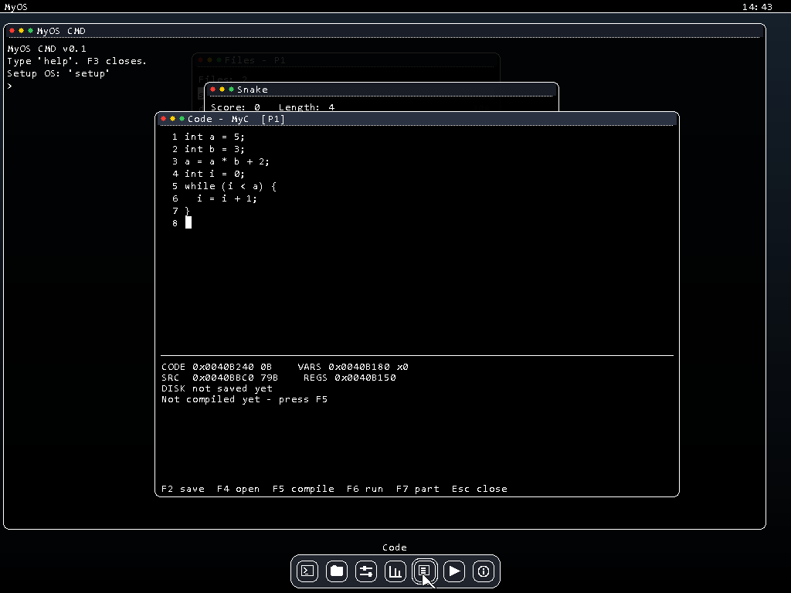

# MyOS — операционная система своими руками

Полный гайд: как собрать, установить и пользоваться.

---

## Быстрый старт (TL;DR)

```powershell
cd D:\C++\MyOS
powershell -ExecutionPolicy Bypass -File build.ps1 -rust
```
В окне QEMU появится **рабочий стол** — нажми **F3** (или кликни по Terminal в доке), набери `help` и нажми Enter.

> В v3.0 ядро написано на **Rust** (`kernel-rs/`). Флаг `-rust` обязателен:
> без него собирается эталонное C++-ядро v2.1 — оно остаётся в проекте для
> сравнения и регрессий.



> Не хочешь собирать сам? Готовый образ системы лежит в
> **[Releases](https://github.com/Fromix1234/MyOS-C-/releases/latest)** — скачай `disk.img`
> и переходи сразу к разделу 4 «Установка на реальную флешку».
> Рядом лежит `disk.img.sha256` — контрольная сумма для проверки.

---

## Что такое MyOS

MyOS — своя операционная система, написанная с нуля:

- **Загрузчик** (NASM): `boot.asm` (MBR) → `vbr.asm` (загрузочный сектор раздела) → `stage2.asm` — выбирает видеорежим (VESA) и включает защищённый режим
- **Ядро v3.0** (Rust, `#![no_std]`, без библиотек и без ОС): память и страницы,
  режим пользователя (ring 3) и системные вызовы, графика VESA, диск (ATA), таймер,
  клавиатура и мышь. Компактное: **36 секторов (~18 КБ)**. Эталонное C++-ядро v2.1
  (`kernel/`) сохранено и собирается без флага `-rust`.
- **Рабочий стол**: меню-бар с живыми часами, док с приложениями (Terminal, Files,
  Settings, Tasks, Code, Game, About); **курсор мыши** и **несколько окон
  одновременно** — перетаскивание за заголовок, закрытие красной точкой, подъём
  кликом, смена фокуса **F1**; консоль **MyOS CMD** открывается из дока
  (клик или **Enter**) или клавишей **F3**; при включении — **заставка с логотипом**

Сейчас система умеет: рисовать экран в любом разрешении (окно занимает весь
экран), принимать ввод с клавиатуры и **мыши**, читать и **писать**
диск, показывать и **создавать** разделы (MBR), создавать свою файловую систему
**MyFS**, хранить в ней файлы, **устанавливать систему в раздел** (`install`)
и **загружаться прямо из раздела** (MBR → VBR → ядро), держать **несколько окон
одновременно** (перетаскивание, закрытие, фокус), играть в «Змейку» и
**компилировать свой код прямо в машинный x86** (приложение Code). Окна, шапки и
док — **«жидкое стекло»**: сквозь них видно то, что нарисовано под ними, а иконки
в доке — настоящие картинки 20×20. Система ставится в любой раздел **графическим
мастером установки** (`setup`) — окном, с мышью. Дальше — фоновые процессы.

---

## 1. Что нужно установить (один раз)

| Инструмент | Зачем | Путь по умолчанию |
|---|---|---|
| NASM | ассемблер загрузчика | `C:\Users\User\AppData\Local\bin\NASM\nasm.exe` |
| w64devkit (g++) | компилятор оболочки ring 3 и эталонного C++-ядра | `C:\Users\User\AppData\Local\Programs\w64devkit\w64devkit\bin` |
| Rust nightly (GNU) + `rust-src` | компилятор Rust-ядра v3.0 | `C:\Users\User\.cargo\bin` |
| QEMU (i386) | «виртуальный компьютер» для запуска | `C:\Program Files\qemu\qemu-system-i386.exe` |

Если пути другие — поправь их в начале `build.ps1` (переменные `$NASM`, `$BIN`, `$QEMU`).

Для Rust-ядра один раз поставь ночной тулчейн с исходниками `core`:

```powershell
rustup toolchain install nightly-x86_64-pc-windows-gnu --component rust-src
```

---

## 2. Сборка

Открой PowerShell:

```powershell
cd D:\C++\MyOS
powershell -ExecutionPolicy Bypass -File build.ps1 -rust -norun
```

Что происходит по шагам:

1. **Компиляция ядра** — `kernel-rs/` (Rust, v3.0) или `kernel/kernel.cpp`
   (C++-эталон v2.1) → `kernel.bin`; находится адрес входа `_kernel_main`
2. **Линковка** — по скрипту `kernel-rs/kernel.ld` (или `kernel.ld` для C++;
   ядро загружается по адресу 0x10000)
3. **Загрузчик** — `boot.asm` → 512-байтный загрузочный сектор; `stage2.asm` → второй этап
   (2 сектора; здесь же драйвер VESA, который ставит видеорежим)
4. **Сборка образа** — всё складывается в `disk.img` (32 МБ): загрузочный сектор + таблица
   разделов MBR, stage2, ядро

Rust-ядро собирается ночным Cargo с `-Z build-std=core`: образ не тянет
`std`/`fmt`/Unicode, поэтому остаётся крошечным (36 секторов). `.bss` в файл
не входит — ядро обнуляет её само на старте; размер для `install`/`SYS_INFO`
берётся из символа `__image_end`, а не зашивается константой.

Без `-rust` собирается C++-ядро v2.1 — удобно для сравнения поведения и
регрессий одной и той же оболочки.

Результат — файл **`disk.img`**: это «флешка» целиком, её можно запускать в QEMU или
записывать на настоящий носитель.

> Флаг `-norun` значит «только собрать, не запускать».

---

## 3. Запуск в QEMU (безопасно)

```powershell
powershell -ExecutionPolicy Bypass -File build.ps1 -rust
```

Сборка выполнится и сразу откроется окно QEMU. Или запустить только QEMU (без пересборки):

```powershell
& "C:\Program Files\qemu\qemu-system-i386.exe" -drive format=raw,file="D:\C++\MyOS\disk.img"
```

QEMU работает **с файлом** `disk.img` — твои реальные диски он не видит и не трогает.
Закрыть окно QEMU = выключить MyOS.

---

## 4. Установка на реальную флешку

> **ВНИМАНИЕ!** Запись образа на флешку **полностью стирает** всё, что на ней было.
> Бери флешку, которую не жалко. Подойдёт любая — образ занимает всего 32 МБ.

1. Скачай **Rufus** (rufus.ie) или **balenaEtcher**
2. Запусти и выбери:
   - **Устройство** — свою флешку
   - **Образ** — `D:\C++\MyOS\disk.img`
   - **Режим записи** — «DD-образ» (в Rufus; в balenaEtcher режим один)
3. Нажми «Старт» / «Flash» и дождись окончания
4. Перезагрузи компьютер и войди в **Boot Menu** (обычно F12, F8, F9 или Esc — зависит от
   платы; подсказка мелькает на экране при включении)
5. Выбери свою флешку в списке загрузки

Важные нюансы:

- MyOS грузится в режиме **BIOS/Legacy (MBR)**. Если система не стартует — зайди в BIOS
  и включи **CSM / Legacy Boot** (режим «только UEFI» не подойдёт).
- Разрешение экрана MyOS выбирает сам через VESA (см. раздел «Видео»): на новом
  компьютере будет 1024×768 или выше, на старой карте — что сможет, например 800×600.
- На реальном ПК **клавиатура и мышь** опрашиваются через **PS/2-порты**. BIOS обычно сам
  «прокидывает» туда USB-устройства (USB Legacy Support), но если клавиши или курсор не
  реагируют — включи в BIOS опцию **USB Legacy Support / Legacy USB**. Собственный
  USB-драйвер — в планах.

---

## 5. Как пользоваться

1. Включаешь компьютер → сначала **заставка**: крупный логотип **MyOS**, подпись и
   полоса загрузки (любая клавиша пропускает её), затем **рабочий стол**: меню-бар
   сверху (`MyOS` + часы), док снизу — 7 приложений: **Terminal** (`>_`),
   **Files** (папка), **Settings** (ползунки), **Tasks** (столбики),
   **Code** (`</>`), **Game** (▶) и **About** (`?`)
2. Стрелками **← / →** выбираешь приложение в доке, **Enter** — запуск;
   над доком показывается имя выбранного приложения
3. **Terminal** открывает консоль **MyOS CMD** (быстрый путь — клавиша **F3**)
4. **Files** — проводник: список файлов MyFS; **← / →** — сменить раздел (P1…P4),
   **↑ / ↓** — выбор файла, **Enter** — посмотреть содержимое, **Esc** — назад/закрыть.
   **Операции прямо в окне:** **N** — создать файл (вводишь имя, потом текст),
   **R** — переименовать, **D** — удалить (с подтверждением **Y/N**), **F** — отформатировать
   раздел (тоже с подтверждением). Работает и с пустым разделом: `F` создаёт MyFS из окна.
5. **Settings** — настройки: **↑ / ↓** — выбрать строку, **Enter** или **← / →** —
   переключить формат часов (24 ч / 12 ч с AM/PM — сразу видно в меню-баре)
6. **Tasks** — диспетчер задач: живой «Uptime», видео, раздел загрузки и список
   компонентов системы (кто `running`, кто `idle`)
7. **Code** — редактор кода **MyC** со встроенным мини-компилятором (подробно в
   разделе «Редактор кода MyC»): набираешь программу (переменные, арифметика,
   условия `if`/`else`, циклы `while`, сравнения), **F5** — компиляция в
   настоящий машинный код x86, **F6** — запуск. Внизу окна видно, **куда лежит код
   и данные в ОЗУ**, **файл на диске**, **байты машинного кода** и **регистры CPU**
   после запуска
8. **Game** — мини-игра **«Змейка»**: стрелки — поворот, ешь еду и расти,
   `Enter` — заново после проигрыша, `Esc` — выход
9. **About** — окно о системе: версия, раздел загрузки, видео; **Esc** его закрывает
10. **F3** в консоли — закрыть её и вернуться на рабочий стол
11. **Установка ОС** — команда `setup` в консоли: открывается **графическое окно
    Installer** (список разделов, выбор мышью или стрелками, кнопки и
    подтверждение; подробнее — «Установить систему в раздел»)

Клавиши на рабочем столе:

| Клавиша | Действие |
|---|---|
| ← / → | выбрать приложение в доке |
| Enter | запустить выбранное приложение (или поднять уже открытое) |
| F1 | переключить фокус на следующее открытое окно (и дальше — на рабочий стол) |
| F3 | сразу открыть консоль CMD |

Мышь:

| Действие | Что происходит |
|---|---|
| клик по иконке в доке | приложение открывается; если его окно уже есть — поднимается наверх |
| клик по окну | окно поднимается и получает клавиатуру — ввод идёт в него |
| клик в окне Installer | выбрать раздел в списке или нажать кнопку |
| перетаскивание за строку заголовка | окно едет за мышью (не уходит под док и за края) |
| клик по красной точке в заголовке | окно закрывается, фокус уходит на следующее |
| просто движение | курсор едет по экрану; иконка дока подсвечивается при наведении |

Клавиши в окнах приложений:

| Окно | Клавиши |
|---|---|
| Files — список | ← / → — раздел, ↑ / ↓ — выбор, Enter — открыть, N — создать, D — удалить, R — переименовать, F — формат, Esc — закрыть |
| Files — просмотр | ↑ / ↓ — прокрутка, Esc — назад к списку |
| Settings | ↑ / ↓ — строка, Enter / ← / → — переключить, Esc — закрыть |
| Tasks | Esc (или Enter / F3) — закрыть; «Uptime» тикает сам |
| Code — редактор | буквы/цифры — ввод, Enter — новая строка, ← ↑ → ↓ — курсор, Home/End — начало/конец строки, F2 — сохранить, F4 — открыть, F5 — компилировать, F6 — запустить, F7 — раздел, Esc — закрыть |
| Code — диалог имени | буквы — имя файла, Backspace — стереть, Enter — применить, Esc — отмена |
| Game (Змейка) | ← ↑ → ↓ — поворот, Enter — заново (после проигрыша), Esc — выход |
| About | Esc (или Enter / F3) — закрыть |
| Installer | ↑ / ↓ — раздел, Tab / ← → — кнопка, Enter — нажать, Esc — назад / закрыть |

Клавиши в консоли:

| Клавиша | Действие |
|---|---|
| буквы/цифры | ввод команды |
| Shift | заглавные буквы и верхние символы |
| Enter | выполнить команду |
| Backspace | стереть символ слева |
| ↑ / ↓ | история команд (пролистать ранее введённые) |
| F3 | закрыть консоль (вернуться на рабочий стол) |

---

## 6. Команды

| Команда | Что делает | Пример |
|---|---|---|
| `help` | список всех команд | `help` |
| `info` | сведения о системе и раздел загрузки | `info` |
| `clear` | очистить окно | `clear` |
| `mem` | карта памяти | `mem` |
| `time` | время из часов CMOS | `time` |
| `echo T` | напечатать текст T | `echo Hello world` |
| `part` | показать таблицу разделов (читает MBR диска) | `part` |
| `mkpart N MB` | создать/изменить раздел N размером MB мегабайт | `mkpart 4 6` |
| `format N` | создать пустую файловую систему MyFS в разделе N | `format 1` |
| `ls N` | список файлов в разделе N | `ls 1` |
| `write N f T` | записать файл `f` с текстом `T` в раздел N | `write 1 hello Hello MyOS` |
| `cat N f` | показать содержимое файла `f` из раздела N | `cat 1 hello` |
| `install N` | показать план установки системы в раздел N (ничего не пишет) | `install 1` |
| `install N yes` | выполнить установку: VBR + stage2 + ядро в раздел N | `install 1 yes` |
| `setup` | графический мастер установки: окно со списком разделов, кнопки и подтверждение | `setup` |
| `play` | открыть мини-игру «Змейка» | `play` |
| `code` | открыть редактор кода MyC | `code` |
| `wtest` | тест записи: пишет узор в LBA 60000 и сверяет | `wtest` |
| `ring3` | запустить программу пользователя в ring 3 (отдельный бинарник, общение через сисколлы) | `ring3` |

### Примеры

**Посмотреть разделы:**

```
> part
MBR partitions:
  P1 type=83 lba=2048 size=8MB
  P2 type=83 lba=18432 size=8MB
  P3 type=83 lba=34816 size=8MB
```

**Создать четвёртый раздел на 6 МБ:**

```
> mkpart 4 6
Created P4: lba=51200 size=6MB
MBR partitions:
  P1 type=83 lba=2048 size=8MB
  P2 type=83 lba=18432 size=8MB
  P3 type=83 lba=34816 size=8MB
  P4 type=83 lba=51200 size=6MB
```

Новый раздел ставится после последнего занятого, начало выравнивается на 1 МБ.
Если места не хватает — команда скажет, сколько максимум МБ влезает.

**Проверить, что диск пишется:**

```
> wtest
Write test @ LBA 60000...
  OK - 512 bytes match
```

**Своя файловая система (MyFS):**

```
> format 1
Formatted P1 as MyFS
> write 1 hello Hello MyOS
Written hello, 10 bytes
> ls 1
MyFS on P1:
  hello  10 bytes
> cat 1 hello
Hello MyOS
```

Файлы хранятся на диске по-настоящему: выключи компьютер, включи снова — `ls 1`
покажет тот же список (проверено: файл переживает перезагрузку).
Если файла нет или раздел не отформатирован — команда честно скажет об этом.

**Установить систему в раздел:**

Самый простой путь — **графический мастер установки**: набери в консоли `setup`
и нажми Enter.

```
> setup
```

Откроется окно **Installer**:



* **список разделов** — `P1 … P4` с адресом (LBA), размером и пометками
  `ACTIVE` (активный раздел) и `MyFS` (на разделе уже есть файловая система);
* строку выбираешь **мышью** или стрелками **↑/↓**; кнопки — щелчком, **Tab**
  или **←/→**; **Enter** — нажать, **Esc** — назад или закрыть окно;
* кнопка **Install** сначала показывает **план** (что именно будет записано:
  VBR, stage2 и ядро — с числом секторов) и ждёт **второго** нажатия — только
  тогда начинается запись. Cancel или Esc отменяют: на диск не уходит ничего.

По окончании в окне появляется `Done! P2 is ACTIVE. Reboot and MyOS boots from
it.` — раздел помечен **активным** (флаг `0x80` в таблице разделов), а в VBR
впечатан номер LBA раздела, поэтому при загрузке система сама найдёт этот
раздел: **MBR → VBR → stage2 → ядро**. Проверить, откуда загрузились, можно
командой `info` (`Boot: P2 (lba=18432)`).

Если хочется вручную — то же самое делают команды `install N` (показать план)
и `install N yes` (установить). Файлы MyFS при установке не задеваются
(проверено: после установки в P2 команда `ls 3` показывает те же файлы).

---

## 7. Как устроен диск (disk.img, 32 МБ)

| Сектор (счёт с 1) | Что там |
|---|---|
| 1 | **MBR** (`boot.asm`) + таблица разделов (байты 446–509) |
| 2 | **VBR** (`vbr.asm`) — загрузочный сектор раздела |
| 3–4 | второй этап `stage2.asm` (2 сектора: драйвер VESA + загрузка ядра) |
| 5 и далее | ядро `kernel.bin` |

Разделы по умолчанию (их пишет `build.ps1`; система уже установлена в P1):

| Раздел | Начало (LBA) | Размер |
|---|---|---|
| P1 (загрузочный) | 2048 | 8 МБ |
| P2 | 18432 | 8 МБ |
| P3 | 34816 | 8 МБ |
| P4 | свободно | — |

### Как устроен раздел (например, P1 начинается с LBA 2048)

Первые 192 сектора любого раздела — **служебная зона загрузки** (её заполняет
`install`), а MyFS начинается только после неё:

| Смещение | Что там |
|---|---|
| +0 (LBA 2048) | **VBR** — загрузочный сектор раздела (`vbr.asm`); LBA раздела впечатан в поле на смещении 504 |
| +1…+2 (LBA 2049–2050) | **stage2** (2 сектора, 1024 байта) |
| +3 (LBA 2051) и дальше | **ядро** (в текущей сборке 161 сектор ≈ 80 КБ) |
| … до +191 | резерв — запас для роста ядра и будущих загрузчиков |
| +192 (LBA 2240) | **суперблок MyFS**: «магия» `MYFS`, версия, размер раздела, адреса таблицы и данных |
| +193 (LBA 2241) | **таблица файлов**: 8 записей по 64 байта — имя, начало данных, размер |
| +194 и дальше | **данные файлов** — пишутся подряд, один за другим |

`format` и `install` не мешают друг другу: `install` пишет только зону +0…+163
(VBR + stage2 + ядро), файлы MyFS лежат дальше и остаются целыми. Максимум
8 файлов на раздел — для учебной ОС достаточно.

**Удаление файла** (кнопка `D` в проводнике) не оставляет «дыр»: данные всех
следующих файлов сдвигаются на освободившееся место, а указатель свободной
области уменьшается — место освобождается сразу и его можно занять новым файлом.

Путь загрузки: **BIOS → MBR (ищет активный раздел) → VBR раздела → stage2 → ядро → kernel_main**.
Свежесобранный образ уже установлен в P1, поэтому грузится сразу из раздела.

---

## 8. Видео: универсальный драйвер VESA

MyOS больше не привязан к одному разрешению: видеорежим выбирается **до** включения
защищённого режима, пока ещё доступен BIOS. Второй этап `stage2.asm` спрашивает
у BIOS список режимов **VESA VBE** (функции `int 10h` 4F00/4F01/4F02), выбирает
подходящий и забирает адрес видеопамяти (linear framebuffer). Ядро рисует прямо
по этому адресу — каждый пиксель пишется как чистый RGB.

- Поддерживаются режимы **24 и 32 бита** на пиксель; 32 бита предпочтительнее.
- Режим берётся из **таблицы предпочтений** в начале `stage2.asm`:
  `1024×768, 1920×1080, 1280×720, 1280×1024, 800×600, 640×480` —
  берётся первая строка, которую BIOS умеет. Хочешь приоритет 1920×1080 —
  поменяй строки местами в таблице и пересобери.
- Если BIOS не предложил ни одного подходящего LFB-режима, система честно
  печатает `ERROR: no VESA LFB mode found!` и останавливается.
- Порядок каналов цвета (R/G/B) читается из описания режима — цвета получаются
  верными и на картах с другим форматом пикселя.
- Раскладка **подстраивается под экран**: консоль, меню-бар, док и окна приложений
  занимают весь экран при любом разрешении (на 1024×768 консоль — 122 колонки,
  на большем экране — шире).

Проверить текущий режим: **`info`** (`Screen: 1024x768x32`) и **`mem`**
(адрес видеопамяти, например `0xFD000000`).

---

## 9. Заставка, «Змейка» и редактор кода MyC

### Заставка при загрузке

Сразу после включения показывается заставка: крупный логотип **MyOS** (символы
шрифта, увеличенные в 5 раз), подпись `mini operating system` и полоса загрузки,
заполняющаяся за ~1.4 с. Любая клавиша пропускает заставку. Часы для анимации
берутся из системного таймера (PIT) — без прерываний.

### Курсор мыши и несколько окон сразу (многозадачность)



Мышь — своя, без прерываний и без BIOS: ядро само **опрашивает PS/2-контроллер**
(порты 0x64/0x60), включает вспомогательное устройство и разбирает 3-байтные
пакеты (сдвиг по X и Y, кнопки, знаки переполнения). Курсор — **стрелка прямо в
видеопамяти**: перед выводом ядро запоминает пиксели под ней, а при движении
возвращает их назад. Поэтому курсор не «размазывается» и не портит картинку.

Окна живут в маленьком оконном менеджере: у каждого приложения есть координаты,
размер и **слой (z-порядок)**. Рабочий стол стал **компоновщиком**: сначала обои,
меню-бар и часы, затем окна от нижнего слоя к верхнему, и в самом конце — док
(он всегда поверх окон) и курсор. Когда одно окно перекрывает другое, консоль
**перерисовывается из своей теневой текстовой сетки** — текст не теряется.

Что можно делать:

- открыть **сколько угодно окон** сразу (Terminal, Files, Settings, Tasks, Code,
  Game, About) — каждое новое встаёт со сдвигом «каскадом», чтобы не закрывать
  предыдущее;
- **перетаскивать** окно, ухватив за заголовок;
- **поднимать** любое окно кликом — вся клавиатура переходит в него (фокус);
- **F1** — циклический обход фокуса: следующее окно → … → рабочий стол;
- **закрывать** окно красной точкой (как в MacOS) или клавишей Esc внутри него.

Пока окно не в фокусе, его «жизнь» приостанавливается: «Змейка» не тикает,
«Uptime» не перерисовывается — время процессора не тратится на невидимое.

### «Жидкое стекло», иконки дока и быстрые заливки

**Стекло.** Окна, шапки и док — полупрозрачные: ядро **смешивает свой цвет с
тем, что уже лежит в видеопамяти** (читает пиксель под собой, считает новый и
пишет обратно). Смотри скриншот выше: сквозь окно Files тускло просвечивают
рамки окон Snake и Code — это настоящая прозрачность, а не серая краска.
Плотность «стекла» у каждой части своя: тело окна почти плотное, чтобы
**текст оставался идеально читаемым**, а шапка, док и подложки иконок
прозрачнее. Обои — очень мягкий тёмный градиент: он почти чёрный, но по нему
видно, что стекло настоящее.

Хитрость для скорости: смешивать можно только **один раз за кадр**. Поэтому
полная компоновка (обои → окна снизу вверх → док) рисуется прозрачно, а
точечные обновления (мигающий курсор консоли, строка Uptime) кладут стекло
плотно — иначе одни и те же пиксели смешивались бы многократно и всё бы
«поплыло».

**Иконки дока** — не символы шрифта, а **картинки 20×20 по битам**: генератор
`icons_gen.ps1` рисует их «по клеточкам» и сохраняет в `icons_data.inc`
(Terminal — окно с `>_`, Files — папка, Settings — ползунки, Tasks — столбики,
Code — страница с кодом, Game — треугольник play, About — «кружок с i»).

**Быстрые заливки.** Самые горячие операции рисования переписаны: заливка
прямоугольника пишет не по пикселю, а **целыми строками командой процессора
`rep stosl`** (по 4 байта за раз), обои — построчно. Плюс ядро собирается с
оптимизацией `-Os`: размер упал с 185 до 161 сектора (~80 КБ), и рисование
стало заметно быстрее.

**Мерцание при открытии окон убрано.** Причин было три, и все закрыты:
(1) смешивание «стекла» ускорено в разы — теперь красный и синий каналы
смешиваются одной парой умножений, зелёный второй, а лишние проверки
(границы экрана, скругление углов) вынесены из горячего цикла;
(2) наведение мыши на иконку дока перерисовывает **только док**, а не весь
экран («окна до дока всё равно не достают» — их положение так и ограничено);
(3) клик по доку рисует ровно **один полный кадр** (раньше — два-три подряд).

### Мини-игра «Змейка»

**Game** в доке (или команда `play`). Поле из клеток; стрелки поворачивают
змейку, еда засчитывается очком и удлиняет её, с ростом очков скорость растёт.
Врезался в стену или в себя — `GAME OVER`, **Enter** перезапускает. **Esc** —
выход. Отрисовка идёт по «такту» (около 140 мс на шаг), который отсчитывает
главный цикл ядра, когда клавиши не нажаты.

### Редактор кода MyC (свой мини-компилятор)

**Code** в доке (или команда `code`) — маленькая IDE прямо внутри MyOS. Сверху —
редактор с нумерацией строк и белым курсором (он мигает), снизу — панель «куда
что легло», в самом низу — строка подсказки или сообщения.

**Язык MyC** — C-подобный, из одного файла. Поддерживаются:

- объявления `int a;` и `int a = 5;` (до 8 переменных, целые числа);
- присваивания `a = a * b + 2;`
- арифметика `+ - * /` и скобки `( )` с обычным приоритетом;
- сравнения `==` `!=` `<` `<=` `>` `>=` (результат — `0` или `1`);
- условия `if (УСЛОВИЕ) { … } else { … }`;
- циклы `while (УСЛОВИЕ) { … }` (можно вкладывать, до 8 уровней);
- `return ВЫРАЖЕНИЕ;` — что вернёт программа (её «результат»).

Фигурные скобки для одного оператора не обязательны: `if (a < b) a = b;`.

Пример (открывается при первом запуске) — допиши `return a;`, результат будет `17`:

```
int a = 5;
int b = 3;
a = a * b + 2;
int i = 0;
while (i < a) {
  i = i + 1;
}
```

**F5 — компиляция.** Ядро разбирает текст и **генерирует настоящие байты
машинного кода x86** в буфер в ОЗУ (числа и переменные → команды
`mov/add/sub/imul/idiv`, вызовы-операнды через стек). Деление на ноль безопасно:
компилятор вставляет проверку `test ecx,ecx / jz` и пропускает деление.

Условия и циклы становятся **настоящими переходами**: сравнение — `cmp` + `setcc`
(0/1 в `eax`), затем `jz`/`jmp`. Компилятор сначала оставляет в потоке байтов
заготовки переходов, а в конце **сам вписывает в них смещения**. У каждого `while`
есть счётчик итераций: если цикл окажется вечным (например, забыли `i = i + 1;`),
он аварийно прервётся, а не подвесит систему.

**F6 — запуск.** Ядро вызывает скомпилированный буфер **как функцию** (`call`) —
код исполняется по-настоящему. В конце код сам сохраняет регистры в ОЗУ и делает
`ret`, поэтому панель может показать их значения.

Панель внизу окна показывает всю цепочку:

| Строка | Что означает |
|---|---|
| `CODE 0x… NB` | адрес буфера машинного кода в ОЗУ и его размер, байт |
| `VARS 0x… xN` | адрес массива значений переменных и сколько их |
| `SRC 0x… NB` | адрес исходника в ОЗУ и его длина |
| `REGS 0x…` | адрес, куда код кладёт регистры |
| `DISK P3 файл @ LBA … xN sect` | где лежит **сохранённый файл** на диске (или `not saved yet`) |
| `BIN …` | **байты** машинного кода (шестнадцатерично) |
| `EAX EBX ECX EDX ESP EBP EFLAGS` | значения **регистров CPU** после запуска |
| `RESULT = N` | значение из `return` |

Так видно всю цепочку: **исходник → адреса в ОЗУ → байты кода → регистры**.

**Сохранить / открыть:** **F2** — сохранить исходник в MyFS (введи имя файла и
Enter), **F4** — открыть сохранённый файл, **F7** — выбрать раздел (P1…P4, виден
в заголовке, например `[P3]`). Перед первым сохранением раздел надо
отформатировать (**Files → F** или команда `format N`), иначе будет честное
«Not MyFS».

---

## 10. Состав проекта

| Файл | Что это |
|---|---|
| `boot.asm` | MBR (512 байт) — находит активный раздел и грузит его VBR |
| `vbr.asm` | VBR (512 байт) — загрузочный сектор раздела, грузит stage2 |
| `stage2.asm` | VESA-режим (видеодрайвер), защищённый режим, GDT, загрузка ядра из раздела (2 сектора) |
| `kernel-rs/src/*.rs` | **ядро v3.0 на Rust**: порты и serial, GDT/TSS/IDT/PIC/PIT, paging, PS/2, ATA/MyFS, планировщик задач, системные вызовы, VESA-графика и заставка |
| `kernel-rs/kernel.ld` | линковка Rust-ядра: плоский образ с 0x10000, `.bss` вне файла, символ `__image_end` |
| `kernel-rs/Cargo.toml` | сборка `no_std`-ядра: nightly, `build-std=core`, `panic=immediate-abort`, `opt-level=s` |
| `kernel/kernel.cpp` | эталонное C++-ядро v2.1 (собирается без флага `-rust`) |
| `kernel.ld` | скрипт линковки C++-ядра (адрес загрузки 0x10000) |
| `user_demo.asm` | программа пользователя (ring 3) — отдельный бинарник, общается с ядром через `int 0x80` |
| `user_demo_data.inc` | те же байты программы, уже в виде C-массива (генерирует `build.ps1`) |
| `font_gen.ps1` | генератор шрифта (Consolas → `font_data.inc`) |
| `font_data.inc` | таблица шрифта 8×16 |
| `icons_gen.ps1` | генератор иконок дока 20×20 (пишет `icons_data.inc`) |
| `icons_data.inc` | битовые карты иконок дока (7 штук по 60 байт) |
| `crop.ps1` | вырезает и увеличивает кусок скриншота (для проверки интерфейса) |
| `build.ps1` | полная сборка + образ + запуск |
| `test_*.ps1` | авто-тесты: сами нажимают клавиши в QEMU и делают скриншоты |
| `ppm2png.ps1` | вспомогательный конвертер: PPM-скриншот QEMU → PNG с верными цветами |
| `disk.img` | готовый образ (результат сборки) |

---

## 11. Пользовательский режим (ring 3): ядро и программы раздельно

Это принцип Linux/Ubuntu: **ядро** живёт в самом защищённом режиме процессора
(ring 0) и одно умеет трогать железо, а **программы** работают в ring 3 и
просят ядро через **системные вызовы** — и больше никак.

Что уже сделано в MyOS:

- **Страницы памяти** (paging, страницы по 4 МБ, PSE): 0..4 МБ — ядро
  (программам туда нельзя: сразу ловушка), 4..8 МБ — программы. Включаются
  регистрами CR0.PG и CR4.PSE — ровно как в Linux.
- **Сегменты ring 3** (0x1B/0x23) и **TSS**: в TSS записано, какой стек ядра
  взять, когда программа входит в ядро. Порты ввода-вывода (I/O) программам
  закрыты — никакого прямого железа.
- **Шлюз `int 0x80`**: `eax` — номер вызова, `ebx/ecx/edx` — аргументы,
  ответ приходит в `eax` (как в Linux на x86). Полный список номеров и структур —
  в `common/myos.h`: `EXIT`, `KEY`, `TIME`, `TICKS`, `PID`, `FB`, `PRINT`,
  `LOG_READ`, файловые `FS_*`, `SPAWN`/`ALIVE`/`YIELD`, `PART_*`, `INSTALL`, `INFO`.
- **Ловушки ошибок процессора** (`#PF`, `#GP`, `#DF`): вместо загадочной
  перезагрузки на экране — «CPU fault: vector N, error code M at адрес
  (pde …)» с адресом, который сломался.
- **Видеопамять отображена программам** (как `/dev/fb0` в Linux): пиксели
  программа рисует напрямую и бесплатно, а вот диск, клавиатура, мышь и
  время — только через сисколлы.
- **Отдельный бинарник**: `user_demo.asm` — это НЕ часть ядра. Он собирается
  nasm-ом в свои ~400 байт, ядро копирует его в 4..8 МБ и уходит туда
  инструкцией `iret`, а обратно программа просит сама (сисколл `EXIT`).

Как посмотреть: набери в консоли `ring3` — ядро уйдёт в ring 3, программа
напечатает приветствие через сисколл, нарисует пульсирующий квадрат **прямо
в видеопамять**, будет читать клавиши сисколлом, а по `Q`/`Esc` вернётся в
ядро (и ядро честно перерисует рабочий стол).

Это уже сделано в v2.0, а в v3.0 ядро переписано на **Rust** с тем же ABI:
графическая оболочка осталась отдельным бинарником `shell.bin` в **ring 3**.
Rust-ядро `kernel.bin` — всего **36 секторов (~18 КБ)**: железо и сисколлы,
а рабочий стол, док и все приложения — обычная программа, которая
лежит на разделе в MyFS и запускается ядром как задача ring 3 (как GNOME в
Ubuntu).

---

## 12. Что дальше (план)

- [x] загрузчик, защищённый режим, ядро
- [x] графика, окно консоли, клавиатура
- [x] чтение диска (ATA), команда `part`
- [x] запись диска (ATA), команда `wtest`
- [x] создание разделов, команда `mkpart`
- [x] своя файловая система (MyFS): суперблок, каталог, файлы
- [x] `format` — создание файловой системы в разделе
- [x] `install` — установка системы в раздел (VBR + stage2 + ядро, с подтверждением)
- [x] мастер установки `setup` — сначала консольный (по шагам), теперь графическое окно Installer
- [x] загрузка не с сырых секторов, а с раздела (MBR → VBR активного раздела → stage2)
- [x] рабочий стол: меню-бар с живыми часами и док приложений
- [x] универсальный графический драйвер VESA: любое разрешение от BIOS, окно на весь экран
- [x] приложения в доке: проводник Files (список файлов MyFS и просмотр), настройки
      Settings (формат часов 24/12), диспетчер задач Tasks (живой Uptime и компоненты)
- [x] операции с файлами в проводнике: создать, переименовать, удалить (с уплотнением данных), формат — всё из окна
- [x] заставка при загрузке: логотип «MyOS» и полоса загрузки
- [x] мини-игра «Змейка» (док и команда `play`)
- [x] редактор кода MyC со своим мини-компилятором в машинный x86, панелью ОЗУ/байтов/регистров и сохранением в MyFS (док и команда `code`)
- [x] мышь: свой драйвер PS/2 (опрос без прерываний), курсор-стрелка, клики,
      наведение на док, перетаскивание окон
- [x] многозадачность: несколько окон сразу, слои (z-порядок), фокус и его обход по F1,
      закрытие красной точкой, перерисовка перекрытых окон (теневая сетка консоли)
- [x] графический мастер установки: окно Installer (список разделов мышью, кнопки, подтверждение)
- [x] «жидкое стекло»: полупрозрачные окна, шапки, док и подложки иконок (смешивание с фоном)
- [x] ускоренные заливки: заливка прямоугольников строками `rep stosl` + сборка ядра с `-Os`
- [x] иконки дока — картинки 20×20 (`icons_gen.ps1` → `icons_data.inc`), а не символы шрифта
- [x] убрано мерцание окон: быстрая смешивалка стекла, перерисовка только дока, один кадр на клик
- [x] режим пользователя (ring 3): страницы и ловушки, сегменты ring 3 и TSS, шлюз `int 0x80`,
      системные вызовы и отдельная программа пользователя (команда `ring3`)
- [x] v2.0: графическую оболочку и приложения — в ring 3 (ядро — только железо и сисколлы):
      kernel.bin + shell.bin, обмен через `int 0x80`
- [x] v2.0: установка из графического мастера реально пишет в выбранный раздел
      (и без эха плана в консоли — тихий режим)
- [x] v2.1: тёмная тема «Night Ridge» — быстрый композит обоев (звёзды, луна, горы)
- [x] v2.1: глобальная клавиша F2 — обзор приложений (Activities)
- [x] v2.1: «живая» «Змейка» — ползёт сама, без нажатий
- [x] v3.0: ядро переписано с нуля на **Rust** (`kernel-rs/`): монолит с жёсткими
      границами модулей (arch/video/input/disk/task/syscall), `no_std`, без CRT
- [x] v3.0: полный паритет ABI `common/myos.h` — те же сисколлы, структуры и
      поведение; оболочка `shell.bin` и `demo.bin` не менялись
- [x] v3.0: компактный образ — 36 секторов (~18 КБ), `.bss` вне файла и
      обнуляется на старте, размер ядра для `install`/`SYS_INFO` — из `__image_end`
- [x] v3.0: проверены загрузка с P1/P2, `install`, `format`, защита
      `shell.bin`/`demo.bin`, файловые операции и обе GUI-регрессии
      (`test_mouse.ps1`, `test_glass.ps1`)
- [ ] фоновые процессы
- [x] в MyC: `if`/`else`, циклы `while`, сравнения `< > <= >= == !=` (настоящие переходы x86)

---

## 13. Безопасность

- В QEMU всё работает с файлом `disk.img` — экспериментируй смело: если что-то сломается,
  `build.ps1` пересоберёт образ с нуля.
- Реальная запись происходит **только когда ты сам** прошьёшь образ на флешку.
- `install` и мастер `setup` ничего не пишут без подтверждения: сначала
  показывается план, запись — только после `install N yes` или **второго**
  нажатия Install в окне мастера. Пишут всегда только в явно указанный раздел
  и только в его служебную зону (первые 192 сектора) — файлы MyFS не задеваются.
  Проверено автотестом: установка в P2, перезагрузка — система грузится из P2,
  а `ls 3` показывает те же файлы MyFS, что были до установки.
