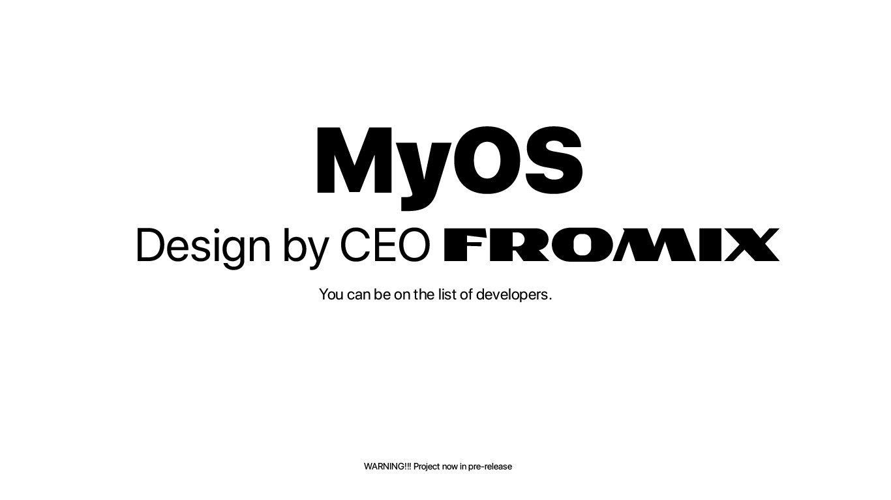

<div align="center">

# 🖥️ MyOS
### *The Future of Minimalist Operating Systems*



---

> [!WARNING]
> **PROJECT STATUS: PRE-RELEASE**
> *The system is currently in active development. Expect frequent updates and experimental features.*

</div>

## 🚀 Overview
**MyOS** — это амбициозный проект по созданию операционной системы с нуля. От низкоуровневого загрузчика до современного графического интерфейса с эффектом «жидкого стекла». 

**Цель проекта:** Доказать, что мощная и функциональная ОС может быть компактной, быстрой и эстетически совершенной.

---

## 🛠️ Technical Architecture
MyOS построена на принципе разделения ядра и оболочки (Ring 0 $\rightarrow$ Ring 3), что обеспечивает стабильность и модульность.

| Компонент | Технология | Описание |
| :--- | :--- | :--- |
| **Bootloader** | NASM | MBR $\rightarrow$ VBR $\rightarrow$ Stage2 (VESA Init) |
| **Kernel (v3.0)** | Rust / C++ | Управление памятью, системные вызовы, драйверы |
| **Shell (GUI)** | C++ | Оконный менеджер, композитор, приложения |
| **FileSystem** | MyFS | Собственная оптимизированная файловая система |

---

## ✨ Key Features
- 🧊 **Liquid Glass UI**: Полупрозрачные окна и элементы интерфейса.
- 🖱️ **Advanced Input**: Поддержка IntelliMouse, скролл-колеса и высокая точность.
- 💻 **MyC Compiler**: Встроенный компилятор в настоящий x86 машинный код.
- 🛠️ **Disk Management**: Графический мастер установки и управления разделами.

---

## 👥 Developers & Community
**"You can be on the list of developers."**

Мы открыты для сотрудничества с теми, кто горит идеей низкоуровневого программирования. Если вы хотите оставить свой след в истории MyOS — присоединяйтесь к нам!

- **CEO & Lead Architect:** [FROMIX](https://github.com/Fromix1234)
- **Contributors:** *Your name could be here...*

---

## 📦 Quick Start (Oracle VM VirtualBox)

### Готовые образы релиза v3.1-pre
- **`MyOS.vdi`** — виртуальный жёсткий диск для VirtualBox;
- **`MyOS.iso`** — загрузочный ISO (El Torito, эмуляция 1.44 MB floppy).

**Вариант A — VDI (рекомендуется):**
1. Создайте VM: **Type** — Other, **Version** — Other/32-bit, RAM — 128 MB.
2. **System → Motherboard**: EFI выключен (MyOS использует BIOS/Legacy).
3. **Storage** → контроллер **IDE** → добавьте `MyOS.vdi` как жёсткий диск.
4. Запустите VM.

**Вариант B — ISO:**
1. Создайте VM без жёсткого диска (или оставьте существующий).
2. **Storage** → **IDE** → DVD-привод → выберите `MyOS.iso`.
3. **System → Motherboard → Boot Order**: оптический привод первым.
4. Запустите VM. Stage2 сам загрузит оболочку из ISO, ATA-диск не нужен.

### Сборка из исходников
```powershell
cd MyOS-C-
powershell -ExecutionPolicy Bypass -File build.ps1
powershell -ExecutionPolicy Bypass -File build_iso.ps1
```
`build.ps1` создаёт `disk.img` (32 MB HDD). `build_iso.ps1` создаёт загрузочный
`MyOS.iso` **без внешних утилит** (собственный генератор ISO9660 + El Torito).
Для VDI:
```powershell
& "C:\Program Files\Oracle\VirtualBox\VBoxManage.exe" convertfromraw disk.img MyOS.vdi --format VDI
```

---
## 👥 Управление проектом и команда

MyOS — независимый проект по разработке собственной операционной системы. Проект возглавляет FROMIX. Разработка ведётся по модульному принципу с разделением ответственности за архитектуру, ядро, драйверы, графическую оболочку, тестирование и выпуск сборок.

### Роли и обязанности

| Роль | Обязанности |
|---|---|
| Руководитель проекта | Планирование, определение приоритетов, контроль сроков и координация разработки |
| Ведущий архитектор | Архитектура системы, технические решения и взаимодействие компонентов |
| Разработчик ядра | Разработка ядра на Rust, управление памятью и системные механизмы |
| Разработчик драйверов | Поддержка оборудования, обработка ввода и низкоуровневые интерфейсы |
| Разработчик графической оболочки | Рабочий стол, оконная система и графические приложения |
| Инженер по тестированию | Проверка работоспособности, поиск ошибок и обеспечение стабильности |
| Инженер по сборке и выпуску | Автоматизация сборок, создание загрузочных образов и подготовка релизов |

**Руководитель проекта:** FROMIX — генеральный директор и ведущий архитектор.

В настоящее время несколько ролей могут совмещаться одним разработчиком. Участники сообщества могут присоединяться к разработке отдельных компонентов системы.

### Матрица ответственности RACI

RACI определяет распределение ответственности за основные задачи проекта:

- **R (Responsible) — Исполнитель:** непосредственно выполняет задачу.
- **A (Accountable) — Ответственный:** отвечает за конечный результат и принимает итоговые решения.
- **C (Consulted) — Консультируемый:** предоставляет технические рекомендации.
- **I (Informed) — Информируемый:** получает информацию о ходе выполнения задачи.

| Задача | Руководитель | Архитектор | Ядро | Драйверы | GUI | Тестирование | Сборка |
|---|---|---|---|---|---|---|---|
| Планирование проекта | A/R | C | I | I | I | I | I |
| Архитектура системы | A | R | C | C | C | I | I |
| Разработка ядра | A | C | R | C | I | C | I |
| Разработка драйверов | A | C | C | R | I | C | I |
| Разработка GUI | A | C | C | C | R | C | I |
| Тестирование системы | A | C | C | C | C | R | C |
| Сборка и выпуск | A | C | C | C | C | C | R |

В текущем формате руководитель проекта также несёт ответственность за принятие ключевых технических решений и итоговое качество системы.

---

## 💰 Финансовая модель проекта

MyOS находится на стадии независимой разработки. Приведённые ниже значения являются предварительной финансовой моделью, а не подтверждёнными доходами или расходами проекта.

### Планируемые ежемесячные расходы

| Статья расходов | Сумма в месяц |
|---|---:|
| Оборудование и амортизация | 2 000 ₽ |
| Электроэнергия | 500 ₽ |
| Хостинг и домен | 500 ₽ |
| Программное обеспечение | 0 ₽ |
| Продвижение проекта | 1 000 ₽ |
| Прочие расходы | 500 ₽ |
| **Итого** | **4 500 ₽** |

### Возможные источники дохода

| Источник дохода | Описание |
|---|---|
| Техническая поддержка | Платная установка, настройка и устранение неполадок |
| Корпоративные лицензии | Коммерческое лицензирование для организаций |
| Платные приложения | Дополнительные программы и приложения для MyOS |
| Пожертвования | Добровольная финансовая поддержка проекта |
| Партнёрские проекты | Совместная разработка и интеграция решений на базе MyOS |

Указанные источники дохода являются возможными направлениями монетизации. Фактическая выручка появится только после начала коммерческой деятельности.

### Пример ежемесячного финансового результата

| Финансовый показатель | Сумма |
|---|---:|
| Выручка | 15 000 ₽ |
| Операционные расходы | 4 500 ₽ |
| **Операционная прибыль** | **10 500 ₽** |
| Рентабельность продаж | 70% |

Операционная прибыль рассчитывается как разница между выручкой и операционными расходами. Она не учитывает налоги и стоимость собственного труда разработчика.

Финансовая модель будет обновляться по мере развития проекта и появления фактических данных о расходах и доходах.
Выше указанная информация про доходы и прибыли(примерное)


gantt
    title MyOS — план разработки
    dateFormat YYYY-MM-DD
    axisFormat %d.%m

    section Архитектура
    Проектирование системы           :done, arch, 2026-10-01, 14d

    section Ядро
    Разработка ядра на Rust           :active, kernel, 2026-10-15, 30d
    Управление памятью                :memory, after kernel, 14d
    Прерывания и системные вызовы     :interrupts, after memory, 14d

    section Драйверы
    Разработка драйверов              :drivers, after interrupts, 30d

    section Графическая система
    Разработка рабочего стола         :ui, 2026-10-15, 30d
    Оптимизация графической оболочки  :optimization, after ui, 21d

    section Тестирование
    Интеграция компонентов            :testing, after drivers, 14d
    Финальное тестирование            :final, after optimization, 14d

<div align="center">
  <sub>© 2026 MyOS Project. All rights reserved. Designed by FROMIX.</sub>
</div>
