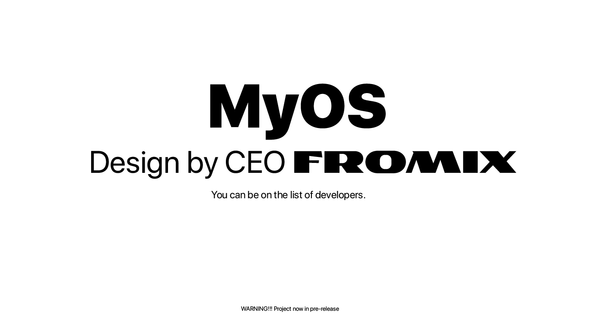

<div align="center">

# 🖥️ MyOS
### *The Future of Minimalist Operating Systems*



**Design by CEO FROMIX**

---

> [!WARNING]
> **PROJECT STATUS: PRE-RELEASE**
> *The system is currently in active development. Expect frequent updates and experimental features.*

</div>

## 🚀 Overview
**MyOS** — это амбициозный проект по созданию операционной системы с нуля. От низкоуровневого загрузчика до современного графического интерфейса с эффектом «жидкого стекла». 

**Цель проекта:** Доказать, что мощная и функциональная ОС может быть компактной, быстрой и эстетически совершенной.

---

## 🛠️ Technical Architecture
MyOS построена на принципе разделения ядра и оболочки (Ring 0 $\rightarrow$ Ring 3), что обеспечивает стабильность и модульность.

| Компонент | Технология | Описание |
| :--- | :--- | :--- |
| **Bootloader** | NASM | MBR $\rightarrow$ VBR $\rightarrow$ Stage2 (VESA Init) |
| **Kernel (v3.0)** | Rust / C++ | Управление памятью, системные вызовы, драйверы |
| **Shell (GUI)** | C++ | Оконный менеджер, композитор, приложения |
| **FileSystem** | MyFS | Собственная оптимизированная файловая система |

---

## ✨ Key Features
- 🧊 **Liquid Glass UI**: Полупрозрачные окна и элементы интерфейса.
- 🖱️ **Advanced Input**: Поддержка IntelliMouse, скролл-колеса и высокая точность.
- 💻 **MyC Compiler**: Встроенный компилятор в настоящий x86 машинный код.
- 🛠️ **Disk Management**: Графический мастер установки и управления разделами.

---

## 👥 Developers & Community
**"You can be on the list of developers."**

Мы открыты для сотрудничества с теми, кто горит идеей низкоуровневого программирования. Если вы хотите оставить свой след в истории MyOS — присоединяйтесь к нам!

- **CEO & Lead Architect:** [FROMIX](https://github.com/Fromix1234)
- **Contributors:** *Your name could be here...*

---

## 📦 Quick Start (Oracle VM VirtualBox)

### Готовые образы релиза v3.1-pre
- **`MyOS.vdi`** — виртуальный жёсткий диск для VirtualBox;
- **`MyOS.iso`** — загрузочный ISO (El Torito, эмуляция 1.44 MB floppy).

**Вариант A — VDI (рекомендуется):**
1. Создайте VM: **Type** — Other, **Version** — Other/32-bit, RAM — 128 MB.
2. **System → Motherboard**: EFI выключен (MyOS использует BIOS/Legacy).
3. **Storage** → контроллер **IDE** → добавьте `MyOS.vdi` как жёсткий диск.
4. Запустите VM.

**Вариант B — ISO:**
1. Создайте VM без жёсткого диска (или оставьте существующий).
2. **Storage** → **IDE** → DVD-привод → выберите `MyOS.iso`.
3. **System → Motherboard → Boot Order**: оптический привод первым.
4. Запустите VM. Stage2 сам загрузит оболочку из ISO, ATA-диск не нужен.

### Сборка из исходников
```powershell
cd MyOS-C-
powershell -ExecutionPolicy Bypass -File build.ps1
powershell -ExecutionPolicy Bypass -File build_iso.ps1
```
`build.ps1` создаёт `disk.img` (32 MB HDD). `build_iso.ps1` создаёт загрузочный
`MyOS.iso` **без внешних утилит** (собственный генератор ISO9660 + El Torito).
Для VDI:
```powershell
& "C:\Program Files\Oracle\VirtualBox\VBoxManage.exe" convertfromraw disk.img MyOS.vdi --format VDI
```

---

<div align="center">
  <sub>© 2026 MyOS Project. All rights reserved. Designed by FROMIX.</sub>
</div>
